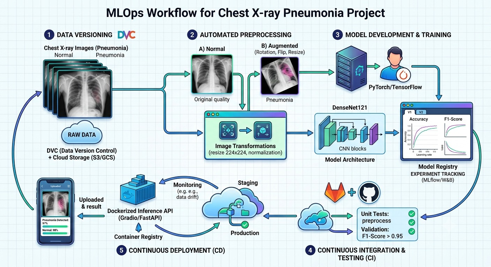

# MLOps Chest X-ray Pneumonia Detection



## Overview

An end-to-end MLOps pipeline for Chest X-ray Pneumonia detection using a DenseNet121 deep learning model. This project implements the full lifecycle: from data versioning and automated preprocessing to model training, evaluation, CI/CD, and deployment of an inference API with drift monitoring.

---

## 🚀 Features & MLOps Pipeline

1. **Data Versioning**: Reproducible data tracked with DVC and synced to cloud storage (S3/GCS).
2. **Automated Preprocessing**: PyTorch data pipeline with class imbalance handling, normalization, and robust data augmentation (rotation, flip, color jitter).
3. **Model Training**: DenseNet121 with transfer learning from ImageNet, optimized with learning rate scheduling and early stopping.
4. **Experiment Tracking**: Full integration with **MLflow** and **Weights & Biases (W&B)** to track metrics, hyperparameters, and model artifacts.
5. **CI/CD Validation Gates**: Automated testing with `pytest`, enforcing strict deployment gates (e.g., F1-Score > 0.95).
6. **Inference APIs**:
   - **FastAPI**: Production-ready REST API for inference.
   - **Gradio**: Interactive web UI with GradCAM visualization.
7. **Containerization**: Fully Dockerized deployment setup with `docker-compose`.
8. **Monitoring**: Data drift detection using **Evidently AI** to monitor incoming inference distributions.

---

## 📂 Project Structure

```
MLOPS PFA/
├── chest_xray/             # Raw dataset (tracked by DVC, ignored by Git)
├── api/                    # Inference API (FastAPI & Gradio)
├── configs/                # Configuration YAML files
├── src/                    # Core source code
│   ├── data/               # Dataset and preprocessing
│   ├── inference/          # Prediction logic and GradCAM
│   ├── models/             # DenseNet121 architecture
│   ├── monitoring/         # Data drift detection
│   └── training/           # Training and evaluation loops
├── tests/                  # Unit and integration tests (Pytest)
├── dvc.yaml                # DVC pipeline definition
├── params.yaml             # Central parameters file
├── docker-compose.yml      # Multi-container setup
└── Dockerfile              # Container image definition
```

---

## 🛠️ Setup & Installation

### 1. Environment Setup

```bash
# Create a virtual environment
python -m venv venv
source venv/bin/activate  # On Windows: venv\Scripts\activate

# Install dependencies
pip install -r requirements.txt
```

### 2. Data Preparation (DVC)

The raw `chest_xray` dataset is tracked by DVC. To download it from remote storage:

```bash
# Initialize DVC if not already done
dvc init

# Set up your remote storage (replace with your S3/GCS bucket)
# dvc remote add -d myremote s3://your-bucket/mlops-pneumonia

# Pull the data
dvc pull
```

---

## 🏃‍♂️ Running the Pipeline

### Option 1: Using DVC (Recommended)

Run the entire reproducible pipeline (prepare data → train model → evaluate) defined in `dvc.yaml`:

```bash
dvc repro
```

### Option 2: Manual Execution

```bash
# 1. Prepare data
python -m src.data.dataset --prepare

# 2. Train the model
python -m src.training.train

# 3. Evaluate the model
python -m src.training.evaluate
```

---

## 🔬 Experiment Tracking

### MLflow

Start the local MLflow tracking server:

```bash
mlflow server --host 127.0.0.1 --port 5000
```
View experiments at: http://127.0.0.1:5000

### Weights & Biases

To enable W&B, edit `configs/training_config.yaml`:
```yaml
wandb:
  enabled: true
  entity: "your-username"
```

---

## 🧪 Testing & Validation

Run the test suite, which includes the CI validation gate (F1 > 0.95):

```bash
# Run all tests
pytest tests/ -v

# Run only the validation gate
pytest tests/test_validation.py -v
```

---

## 🐳 Deployment (Docker & APIs)

### Run APIs using Docker Compose

This starts the FastAPI server, Gradio UI, and MLflow server:

```bash
docker-compose up --build -d
```

- **FastAPI**: http://localhost:8000
- **FastAPI Docs**: http://localhost:8000/docs
- **Gradio UI**: http://localhost:7860
- **MLflow**: http://localhost:5000

### Example API Request (FastAPI)

```bash
curl -X POST "http://localhost:8000/predict" \
  -H "accept: application/json" \
  -H "Content-Type: multipart/form-data" \
  -F "file=@path_to_test_image.jpeg"
```

---

## 📊 Monitoring

The `src/monitoring/drift.py` module uses Evidently AI to detect data drift.

1. Compute reference stats on your training data:
   ```python
   from src.monitoring.drift import DataDriftDetector
   DataDriftDetector.compute_reference_stats("data/processed/train")
   ```
2. The drift detector will track incoming API requests and flag significant deviations in pixel intensity distributions or prediction ratios.

---

## ⚙️ CI/CD

The project includes configuration for both **GitHub Actions** (`.github/workflows/ci_cd.yml`) and **GitLab CI** (`.gitlab-ci.yml`).

The pipelines automatically run linting, unit tests, model validation, and build/push Docker images to a container registry.
